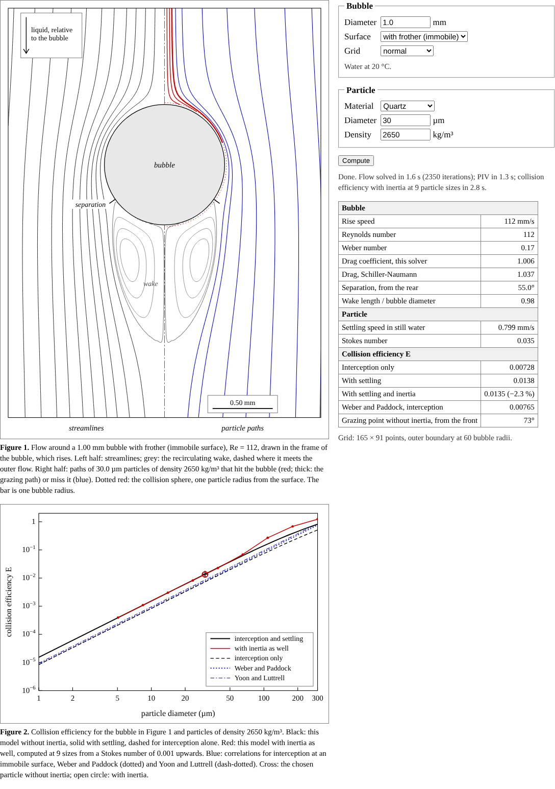

# Bubble and particle collision

The flow around a rising bubble, the particles that hit it, and synthetic PIV of the same flow.
It is a single-page browser program: everything is computed in the browser, with no server and
no libraries.

**Open the program:** https://hashimishaque.com/bubble-particle-collision/

## About the data

This is a theoretical simulation. The flow is computed from the Navier-Stokes equations, the
particles and the PIV images are generated by the program, and the comparison values come from
published equations and correlations. No measured data, and no data from any research centre,
were used.

## Background

During my studies I worked on the flow around rising bubbles and on how particles reach them. This
program is a separate, purely theoretical project, written in 2026, and uses no data from that
work.

## What it does

- Solves the steady, axisymmetric Navier-Stokes equations for water flowing past a spherical
  bubble, for an immobile surface (water with frother) or a mobile one (clean water). The rise
  speed comes from a force balance with the Schiller-Naumann or the Mei, Klausner and Lawrence
  drag correlation.
- Follows particles through the flow with the Maxey-Riley equation (drag, settling, pressure
  gradient and added mass) and finds the collision efficiency from interception, settling and
  inertia, next to the Sutherland, Weber-Paddock and Yoon-Luttrell correlations.
- Renders two synthetic PIV frames of tracers that move with the computed flow and evaluates them
  with FFT cross-correlation, a sub-pixel peak fit, a second pass with window offset and the
  normalised median test. Because the exact flow is known, every PIV vector can be checked, which
  shows where PIV next to a bubble surface stops being reliable.

## Method in short

| Part | Method |
|---|---|
| Flow | Stream function and vorticity on a grid uniform in ln r and θ. Second-order central differences, with deferred correction for the convection terms. SOR for the stream function, under-relaxation for the vorticity. |
| Drag | From the surface vorticity and its normal derivative. |
| Particles | Maxey-Riley equation without the history and lift forces, added-mass coefficient 1/2. Fourth-order Runge-Kutta, or an exponential integrator below a Stokes number of 0.02, where the equation is stiff. |
| Collision efficiency | Exact from the particle stream function for particles without inertia; bisection on trajectories that start 8 bubble radii upstream for particles with inertia. |
| Synthetic PIV | Gaussian particle images integrated over the pixels, with background, noise and 8-bit quantisation. 32 px windows at 50 % overlap by default. |

## Checks

`node checks.js` runs every check below and writes `checks.json`, which the page shows. It takes
about three minutes.

| Check | Expected | Normal grid | Fine grid | Source |
|---|---|---|---|---|
| **Flow past a sphere with an immobile surface** | | | | |
| Drag coefficient, Re = 0.1 | 244.1 | 244.7 | 244.5 | Proudman and Pearson (1957) expansion |
| Drag coefficient, Re = 50 | 1.57 | 1.567 | 1.571 | Johnson and Patel (1999) |
| Wake length / diameter, Re = 50 | 0.40 | 0.42 | 0.41 | Johnson and Patel (1999) |
| Separation angle from the rear, Re = 50 | 40.7° | 40.8° | 40.8° | Clift, Grace and Weber (1978) |
| Drag coefficient, Re = 100 | 1.08 | 1.068 | 1.077 | Johnson and Patel (1999) |
| Wake length / diameter, Re = 100 | 0.88 | 0.87 | 0.88 | Johnson and Patel (1999) |
| Separation angle from the rear, Re = 100 | 53.5° | 53.2° | 53.2° | Clift, Grace and Weber (1978); Johnson and Patel (1999): 53° |
| Drag coefficient, Re = 150 | 0.90 | 0.860 | 0.871 | Johnson and Patel (1999) |
| Wake length / diameter, Re = 150 | 1.20 | 1.22 | 1.21 | Johnson and Patel (1999) |
| Separation angle from the rear, Re = 150 | 59.6° | 59.5° | 59.5° | Clift, Grace and Weber (1978) |
| **Flow past a spherical bubble with a clean (mobile) surface** | | | | |
| Drag coefficient, Re = 0.1 | 161.9 | 162.1 | 162.1 | Mei, Klausner and Lawrence (1994); Hadamard-Rybczynski limit 16/Re = 160 |
| Drag coefficient, Re = 10 | 2.477 | 2.442 | 2.441 | Mei, Klausner and Lawrence (1994) |
| Drag coefficient, Re = 50 | 0.678 | 0.675 | 0.674 | Mei, Klausner and Lawrence (1994) |
| Drag coefficient, Re = 100 | 0.375 | 0.377 | 0.376 | Mei, Klausner and Lawrence (1994) |
| **Collision efficiency, exact limits** | | | | |
| Stokes flow, interception, dp/db = 0.05 | 3.6905 × 10−3 | 3.6905 × 10−3 |  | Exact for Stokes flow; Gaudin (1957) for small particles |
| Potential flow, interception, dp/db = 0.05 | 0.15012 | 0.15012 |  | Exact for potential flow; Sutherland (1948) for small particles |
| Stokes flow, settling only (point particle, settling speed 0.1 U) | 0.09091 | 0.09091 |  | Exact: ws / (U + ws) |
| **Collision efficiency, immobile surface, interception only** | | | | |
| E / (dp/db)² for small particles, Re = 1 | 1.73 (Yoon and Luttrell: 1.77) | 1.72 | 1.72 | Weber and Paddock (1983) |
| E / (dp/db)² for small particles, Re = 10 | 2.98 (Yoon and Luttrell: 2.90) | 2.93 | 2.93 | Weber and Paddock (1983) |
| E / (dp/db)² for small particles, Re = 50 | 5.86 (Yoon and Luttrell: 5.96) | 5.72 | 5.71 | Weber and Paddock (1983) |
| E / (dp/db)² for small particles, Re = 100 | 8.07 (Yoon and Luttrell: 8.84) | 7.91 | 7.90 | Weber and Paddock (1983) |
| **Particle trajectories** | | | | |
| Without inertia (Stokes number 10−7), immobile surface, Re = 100, dp/db = 0.03, ws/U = 0.02: E from integrated paths | 0.02604 (fine grid: 0.02602) | 0.02602 | 0.02601 | Exact for the same flow, from the particle stream function; difference −0.07 % |
| Without inertia (Stokes number 10−7), mobile surface, Re = 100, dp/db = 0.03, ws/U = 0.02: E from integrated paths | 0.09168 (fine grid: 0.09163) | 0.09164 | 0.09159 | Exact for the same flow, from the particle stream function; difference −0.05 % |
| With inertia: 30 µm quartz, 1.0 mm bubble with frother (Re = 111.8, Stokes number 0.035), exponential integrator against Runge-Kutta | 0.01346 | 0.01346 |  | Same flow; difference −0.02 % |
| **Synthetic PIV** | | | | |
| Uniform shift of 2.3 and −1.7 pixels, 32 px windows: random error of one displacement component | about 0.05 px or less | 0.037 px |  | Typical for 32 px windows: Raffel et al. (2018) |

## Files

| File | Contents |
|---|---|
| `index.html` | The program, built from the files below |
| `flow.js` | Flow solver, particle motion and collision efficiency |
| `piv.js` | Synthetic PIV images and their evaluation |
| `template.html` | The page around the code: text, figures and form |
| `checks.js`, `checks.json` | The checks and their results |
| `build.py` | Puts the page together: `python3 build.py` |

`flow.js` and `piv.js` are plain JavaScript without dependencies and also run in Node.js 18 or
newer.

## Limitations

- Steady, axisymmetric flow past a spherical bubble, so the bubble diameter is limited to 1.2 mm
  with frother (Re below about 160) and 0.7 mm in clean water.
- The surface is either fully immobile or fully mobile.
- Collision only, not attachment: no film drainage, no surface forces. The particle does not
  disturb the flow.
- The PIV images are idealised: motion in the light sheet only, no reflections at the bubble.

## References

The page lists all references. The main ones are Clift, Grace and Weber, *Bubbles, Drops, and
Particles* (1978); Johnson and Patel, J. Fluid Mech. 378 (1999) 19; Mei, Klausner and Lawrence,
Phys. Fluids 6 (1994) 418; Maxey and Riley, Phys. Fluids 26 (1983) 883; Weber and Paddock,
J. Colloid Interface Sci. 94 (1983) 328; Dai, Fornasiero and Ralston, Adv. Colloid Interface
Sci. 85 (2000) 231; Raffel et al., *Particle Image Velocimetry* (2018); Westerweel and Scarano,
Exp. Fluids 39 (2005) 1096.

## License

MIT, see `LICENSE`.
